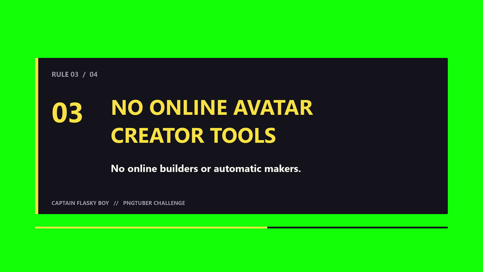

# ContentMotionTextGraphicsAssitant

Native Windows motion graphics from explicit JSON instructions. Made by **Captain Flasky Boy**. Open source under MIT. Executable: **cmtga.exe**.

Create crisp titles, challenge rules, terminal panels, counters, callouts and simple flowcharts over solid green, ready for chroma keying in a video editor. No GUI, server, AI model, browser or FFmpeg runtime dependency. Silent H.264 MP4 is the default output.

[Download Windows builds](https://github.com/captainflaskyboy-create/ContentMotionTextGraphicsAssitant/releases/latest) · [Finished challenge demo](https://github.com/captainflaskyboy-create/ContentMotionTextGraphicsAssitant/releases/download/v0.1.0/challenge-rules.mp4).

For a single-file download, choose [**cmtga.exe**](https://github.com/captainflaskyboy-create/ContentMotionTextGraphicsAssitant/releases/latest/download/cmtga.exe). Save it to a folder and run it from PowerShell. No installation or extraction is required:

```powershell
.\cmtga.exe doctor
.\cmtga.exe text --text "CHALLENGE ACCEPTED" --preset impact --duration 3 --output title.mp4
```

This is a command-line application; run it in a terminal. `cmtga licenses` prints the licence notices embedded in the executable. The ZIP also includes editable examples and documentation.



## Build and installation

Windows 10/11 x64 is required. Install Rust stable and Visual Studio Build Tools with **Desktop development with C++**, including a Windows SDK, if they are not already available. Windows N editions may need the Media Feature Pack. Nothing is installed automatically.

```powershell
cargo build --release --locked
.\target\release\cmtga.exe doctor
```

Copy `cmtga.exe` wherever you keep portable tools and invoke its full path. The tool does not change PATH. MSVC is the recommended release target; an existing Rust GNU toolchain with MinGW-w64 also works.

For a distributable build, run `scripts/build.ps1` to remove workstation-specific paths embedded by dependencies before packaging.

## Usage

```powershell
.\cmtga.exe render --request examples\challenge-rules.json --output challenge-rules.mp4
.\cmtga.exe text --text "CHALLENGE ACCEPTED" --preset impact --duration 3 --output title.mp4
.\cmtga.exe text --text "DRAW | RIG | ANIMATE" --preset flowchart --duration 5 --output workflow.mp4
.\cmtga.exe validate --request examples\challenge-rules.json
.\cmtga.exe render --request examples\challenge-rules.json --theme themes\captain-flasky-boy.json --output "output folder\rules.mp4" --overwrite
.\cmtga.exe batch --request examples\batch.json
```

Output directories must already exist. Existing files require `--overwrite`. Use `--acceleration software` for WARP graphics and software encoding; `auto` is the default and retries a failed native graphics/encoding path through software. Each successful render decodes its temporary MP4 to verify dimensions and frame count before publishing it.

`doctor` reports native graphics and registered H.264 encoders; registration alone does not establish that a particular scene can encode. `capabilities` lists supported commands and presets. `schema` prints the JSON Schema. `preset --name impact --text "YOUR TITLE" --duration 3` prints a reusable scene. `--request -` reads JSON from stdin.

Requests use a 1920x1080 logical canvas scaled to the selected output size; default export is 1920x1080 at 30 fps, approximately 20 Mbps. Frame rate is rational. Use JSON to change dimensions, colours, timing and layers. Text is measured with DirectWrite and fitted before rendering. Set `min_font_size` to enforce readability.

All results are JSON on stdout; progress and diagnostic JSON go to stderr. Exit codes: 0 success; 2 invalid arguments/scene; 3 output conflict; 4 missing native components; 5 render/I/O failure; 130 cancellation. Batch records each job result, continues after job failures, and exits nonzero if any fail. Ctrl+C cancels the active render. Handled failures discard temporary outputs; abrupt process termination can leave `.partial.mp4` files.

JSON image paths resolve relative to the scene file. Batch request/output paths resolve relative to the batch file. CLI output and theme paths resolve relative to the working directory. Stdin paths resolve relative to the working directory. Quoted Windows paths and Unicode text are supported.

Default fonts are Arial Black, Segoe UI and Consolas. Missing fonts fall back to Segoe UI, then Arial, with warnings. Fonts are not bundled. The Captain Flasky Boy palette is configurable and is not claimed to be an exact brand specification. Avoid green foreground colours; H.264 chroma subsampling can soften coloured edges, so use strong dark outlines and readable sizes.

## Development

```powershell
cargo fmt --check
cargo clippy --all-targets --locked -- -D warnings
cargo test --locked
cargo test --release --locked -- --ignored --test-threads=1
.\scripts\verify.ps1
.\scripts\benchmark.ps1
.\scripts\package.ps1
```

See [scene and preset documentation](docs/scenes.md), [agent usage](docs/agent-guide.md), [verification results](docs/verification.md) and [third-party notices](THIRD_PARTY_NOTICES.md). Native integration tests generate and decode actual MP4 files. Optional development-only FFmpeg tools can independently inspect decoded output. There is no mandatory preview stage.

## Credits

Copyright 2026 Captain Flasky Boy. Selected Windows graphics/encoding infrastructure is adapted from [ContentEditorAssitant](https://github.com/captainflaskyboy-create/ContentEditorAssitant), with its MIT notice retained. This repository has no runtime or internal-library dependency on that project.
